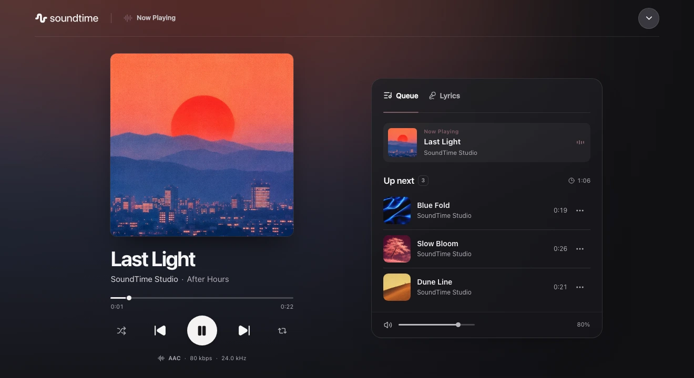

# SoundTime

<p align="center">
  
</p>

SoundTime is a self-hosted music server for your own audio collection. Browse by artist or album, build a queue, and listen from a desktop or mobile browser. You decide who can access the web catalog and whether your server shares music with other SoundTime instances.

[Quick start](#quick-start) · [Library and playback](#library-and-playback) · [Operating an instance](#operating-an-instance) · [Development](#development) · [API reference](docs/api-reference.md)



## Quick start

This setup uses Git, OpenSSL and Docker with Compose v2. Compose pulls the published AMD64 or ARM64 images from GitHub Container Registry. To run changes from your checkout, follow the [development setup](#development).

### 1. Configure a new instance

```sh
git clone https://github.com/CICCADA-CORP/SoundTime.git
cd SoundTime
(umask 077 && cp .env.example .env)
```

Open `.env` and set the following values before starting the containers. Run `openssl rand -hex 32` twice to generate two independent secrets.

| Setting | What to enter |
| --- | --- |
| `POSTGRES_PASSWORD` | The first generated value. Compose uses it for PostgreSQL and the backend connection. |
| `JWT_SECRET` | The second generated value. Keep it across upgrades so existing sessions remain valid. |
| `P2P_ENABLED` | Set to `false` for a standalone server. The Compose default is `true`. |

For an automated installation with the default peer networking settings, the project also ships a Bash installer. It generates credentials on a fresh installation and uses `~/soundtime` by default. [Installer and usage](install.sh)

### 2. Start the services

```sh
docker compose config --quiet
docker compose pull
docker compose up -d
docker compose ps
```

Open the setup wizard through Nginx and create the administrator account. Choose **Private Instance** to require sign-in for the catalog and audio streams and to close public registration. For a standalone server, also turn off **P2P Network (iroh)** in the wizard. Complete setup before giving other people access. [Open setup](http://localhost:8880/setup)

### 3. Play your first track

Sign in, open **Upload**, and add an audio file. Open **Tracks** and press **Play**. SoundTime reads artist, album and cover tags during import. A track without an album stays in **Tracks** and on its artist’s page. An explicitly named album appears in **Albums**, even when you own only one of its tracks.

## Library and playback

- **Import a collection.** Upload MP3, FLAC, Ogg, WAV, AAC, Opus, M4A or AIFF files. SoundTime converts AIFF uploads to FLAC. On Linux, you can also mount an existing SMB or NFS library read-only and import its files from the administration panel. [Network library setup](docs/deployment.md#read-only-smb-and-nfs-music-libraries)
- **Choose what plays next.** Search for a track, album or artist, build a playlist, or start a radio station from a track, artist or genre. The player keeps the queue available as you browse and supports seeking, shuffle, repeat and lock-screen controls on compatible browsers.
- **Keep a personal collection.** Save favorites, revisit listening history and make playlists public or private. Explore brings together recent releases, trending tracks and genres from the catalog.
- **Fill in missing metadata.** Administrators can look up a track on MusicBrainz or run a batch for tracks missing a recording ID. Each run checks its starting list once and reports matches, empty results and provider errors separately.

## Operating an instance

Nginx serves the web interface and the API on the same origin. The default web port is **8880** and can be changed with `NGINX_PORT`. The stock Compose file also publishes the frontend on TCP 3000, the backend on TCP 8080 and the peer transport on UDP 11204 by default. For an internet-facing installation, configure HTTPS and restrict host ports to the services you intend to expose. [Deployment guide](docs/deployment.md)

| Data to keep | Default location |
| --- | --- |
| Accounts, catalog, playlists and instance settings | PostgreSQL 16 with pgvector, in the `postgres_data` volume |
| Uploaded audio and artwork | The `music_data` volume, or your configured S3-compatible bucket |
| Peer identity and blob store | The `p2p_data` volume |
| Database credentials and token-signing secret | The install directory’s `.env` file |

Before an upgrade, back up the database, media, configuration and any peer store. If the instance has an iroh-blobs 0.96 store, follow the index migration procedure before starting a newer backend. The backend applies database migrations at startup. [Backups](docs/deployment.md#backups) · [P2P upgrade and rollback](docs/p2p-networking.md#upgrading-the-p2p-store)

From the install directory, update the checkout and restart with the published images.

```sh
git pull --ff-only
docker compose pull
docker compose up -d
```

To check a running instance, request `/healthz` through Nginx. If it fails, inspect startup and database connection messages with `docker compose logs --tail=100 backend`. [Local health endpoint](http://localhost:8880/healthz)

### Connecting peers

Web access and federation have separate controls. With P2P enabled, SoundTime instances can exchange catalog information and transfer audio over encrypted iroh connections. An administrator can add a known peer by its node ID. Operators can also configure a shared rendezvous for discovery. Keep the peer identity volume across restarts so other operators can continue to reach the same node. [Peer networking guide](docs/p2p-networking.md)

## Development

The browser client uses Svelte 5, SvelteKit and shadcn-svelte. The Rust backend uses Axum for HTTP, SeaORM for PostgreSQL, Lofty for audio tags and Symphonia for waveform analysis. Redis tracks trending plays in the Compose deployment. [Architecture](docs/ARCHITECTURE.md)

CI uses **Rust 1.97** and **Node.js 24**. For local development, start PostgreSQL 16 with pgvector and set `DATABASE_URL` and `JWT_SECRET` in the repository’s `.env`. If PostgreSQL runs in Compose, enable its loopback port mapping and use the same database password in `DATABASE_URL`. Run the following commands from the repository root in separate terminals. [Development setup](docs/development.md#quick-setup)

```sh
cd backend
cargo run --locked -p soundtime-server
```

```sh
cd frontend
npm ci
npm run dev
```

The development client proxies `/api` to the backend on port 8080. [Open the development client](http://localhost:5173)

| Check | Run from | Command |
| --- | --- | --- |
| Rust workspace tests | `backend/` | `cargo test --locked --workspace --all-features` |
| Svelte and TypeScript checks | `frontend/` | `npm run check` |
| Frontend unit tests | `frontend/` | `npm test` |
| Private-instance playback through Nginx | Repository root, after `npm ci` in `frontend/` | `./scripts/test-private-listening.sh` |

The playback test starts a disposable Compose project and exercises the browser in headless mode. CI also runs the PostgreSQL integration tests against a dedicated test database. [CI workflow](.github/workflows/ci.yml)

## Project resources

| I want to… | Where to go |
| --- | --- |
| Configure storage, a domain or TLS | [Self-hosting guide](docs/SELF_HOSTING.md) · [Deployment reference](docs/deployment.md) |
| Build an integration or an extension | [HTTP API](docs/api-reference.md) · [Plugin development](docs/plugin-development.md) · [Themes](docs/themes.md) |
| Follow changes or contribute a patch | [Changelog](CHANGELOG.md) · [Contributing](CONTRIBUTING.md) · [Code of conduct](CODE_OF_CONDUCT.md) |
| Ask a question or report a bug | [GitHub Discussions](https://github.com/CICCADA-CORP/SoundTime/discussions) · [Discord](https://discord.gg/UVCZCNcJvM) · [Issue tracker](https://github.com/CICCADA-CORP/SoundTime/issues) |
| Report a security vulnerability privately | [Security policy](SECURITY.md) |

## License

SoundTime is maintained by CICCADA and distributed under the GNU Affero General Public License, version 3 or later (`AGPL-3.0-or-later`). [License text](LICENSE)

Each operator is responsible for the media they host and share. Use recordings you have permission to distribute when sharing with peers. Rights holders can contact the operator of the instance serving the recording.
