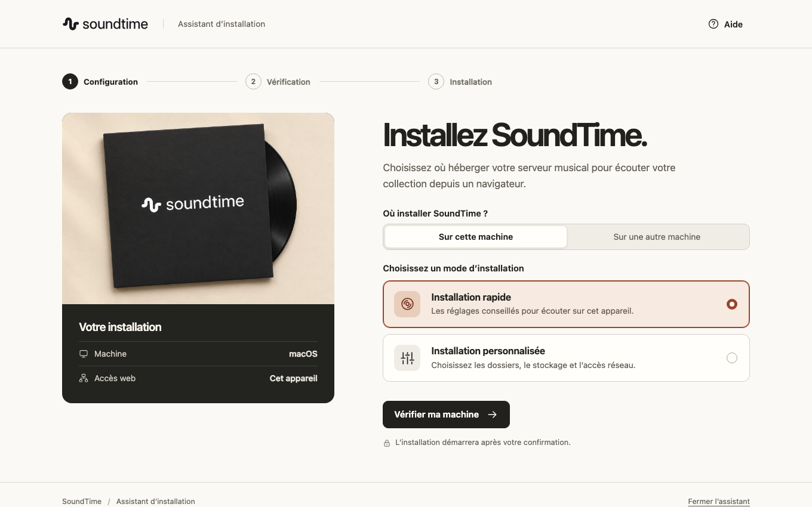

# Installer SoundTime

Ouvrez l’assistant sur votre ordinateur. Vous pouvez y héberger SoundTime, piloter l’installation sur un serveur Linux ou préparer un projet pour votre NAS. La machine qui héberge SoundTime doit rester allumée avec Docker en marche pendant l’écoute.



## Ouvrir l’assistant

Dans les fichiers joints à une version de SoundTime, choisissez le paquet de votre machine. Les paquets autonomes contiennent déjà Python. [Téléchargements par système dans le README](../README.md#guided-installation)

| Votre machine | Fichier | Comment l’ouvrir |
| --- | --- | --- |
| Mac avec puce Apple (M1, M2 ou suivante) | `SoundTime-Installer-macOS-arm64.zip` | Décompressez le ZIP et ouvrez **SoundTime Installer**. |
| Mac Intel | `SoundTime-Installer-macOS-x64.zip` | Décompressez le ZIP et ouvrez **SoundTime Installer**. |
| PC Windows Intel ou AMD | `SoundTime-Installer-Windows-x64.zip` | Choisissez **Extraire tout**, puis ouvrez **SoundTime-Installer.exe**. |
| PC Windows ARM | `SoundTime-Installer-Windows-arm64.zip` | Choisissez **Extraire tout**, puis ouvrez **SoundTime-Installer.exe**. Docker Desktop pour Windows ARM requiert WSL 2. |
| Linux Intel ou AMD 64 bits | `SoundTime-Installer-Linux-x64.tar.gz` | Extrayez l’archive et lancez **SoundTime-Installer**, ou tapez `./SoundTime-Installer` dans le dossier extrait. |
| Linux ARM 64 bits, par exemple un Raspberry Pi avec OS 64 bits | `SoundTime-Installer-Linux-arm64.tar.gz` | Extrayez l’archive et lancez **SoundTime-Installer**. |

Sur Mac, le menu ** → À propos de ce Mac** indique votre puce. Sous Windows, consultez **Paramètres → Système → Informations système → Type du système**. Les exécutables Linux sont construits sur Ubuntu 22.04 et requièrent une distribution compatible avec glibc 2.35 ou ultérieure.

### Depuis le dossier du projet

L’archive légère `SoundTime-Installer-sources.zip` fonctionne également sur les trois systèmes avec Python 3.9 ou ultérieur. Extrayez-la entièrement, puis double-cliquez sur `installer/Lancer.command` sur Mac ou `installer/Lancer.cmd` sous Windows. Les mêmes lanceurs figurent dans les sources du projet. Sur Linux ou macOS, vous pouvez aussi ouvrir un terminal dans le dossier extrait et exécuter la commande suivante. [Télécharger Python](https://www.python.org/downloads/)

```sh
python3 installer/launcher.py
```

## Choisir la machine qui hébergera la musique

| Vous avez… | Parcours |
| --- | --- |
| Un Mac, un PC ou un ordinateur Linux qui reste allumé | Installez sur cet ordinateur en mode rapide ou personnalisé. |
| Un NAS Synology ou QNAP compatible avec les conteneurs Linux 64 bits | Choisissez le NAS et exportez le projet Compose. Ouvrez le guide NAS ci-dessous pour le démarrer. |
| Un serveur Linux, un VPS, une machine virtuelle ou une instance cloud | Choisissez cette cible, puis l’installation par SSH pour la piloter depuis votre ordinateur. L’export Compose permet aussi de confier le projet à une personne qui gère le serveur. |
| Un bucket S3 ou compatible S3 | Choisissez d’abord la machine qui fera fonctionner SoundTime, puis sélectionnez S3 comme stockage audio. |

### Installer sur cet ordinateur

1. Dans le navigateur, choisissez cet ordinateur puis **Installation rapide** pour écouter sur cet ordinateur ou **Installation personnalisée** pour choisir les dossiers, le port web, le nom d’hôte, l’accès depuis votre réseau et le partage entre serveurs SoundTime. Utilisez **Parcourir** pour sélectionner les dossiers sur cet ordinateur.
2. Cliquez sur **Vérifier ma machine**. Si Docker manque sur Mac ou Windows, installez Docker Desktop, ouvrez-le et attendez le démarrage du moteur. Sous Windows, choisissez les conteneurs Linux. Sur un serveur Linux, installez Docker Engine et le module Docker Compose. L’assistant utilise Compose 2.24.4 ou ultérieur. Relancez la vérification dans le même onglet. [Docker pour Mac](https://docs.docker.com/desktop/setup/install/mac-install/) · [Docker pour Windows](https://docs.docker.com/desktop/setup/install/windows-install/) · [Docker Engine pour Linux](https://docs.docker.com/engine/install/) · [Module Compose](https://docs.docker.com/compose/install/linux/)
3. Sélectionnez **Installer SoundTime**. Le premier téléchargement nécessite une connexion Internet. L’assistant génère les identifiants internes et démarre les services. Vous pouvez suivre chaque étape dans le journal.
4. Cliquez sur **Ouvrir SoundTime**. Dans le nouvel onglet, créez votre compte administrateur et finalisez la configuration. Choisissez une instance privée si vous souhaitez réserver l’écoute aux personnes connectées. Pour le réseau P2P, reprenez votre choix de partage dans cet écran. Avec l’installation rapide, désactivez-le. Ouvrez **Importer**, ajoutez un fichier audio, puis lancez sa lecture depuis le catalogue.
5. Si vous avez choisi l’accès depuis le réseau, revenez dans l’onglet de l’assistant après avoir créé le compte. Cliquez sur **Activer l’accès réseau**. Ouvrez ensuite l’adresse indiquée sur un téléphone ou un ordinateur connecté à votre réseau. Ce mode publie le port web sur les interfaces de la machine. Pour un serveur public, configurez aussi HTTPS et son pare-feu. [Déploiement](deployment.md)

Fermez l’assistant avec **Fermer l’assistant**. SoundTime continue à fonctionner dans Docker. Enregistrez l’adresse de SoundTime dans vos favoris pour votre prochaine écoute.

## Installer sur un NAS

Vérifiez que votre modèle possède un processeur x86-64 ou ARM64 et propose Container Manager ou Container Station. Sur votre ordinateur, choisissez une autre machine, puis **NAS** et **Projet Docker à importer**. Sélectionnez votre gestionnaire Synology, QNAP ou autre pour adapter le chemin suggéré. Indiquez un dossier de projet dédié **sur le NAS**. Pour écouter sur le réseau local, sélectionnez l’accès réseau. Téléchargez le projet puis extrayez tous ses fichiers dans ce dossier, y compris le fichier caché `.env`, le dossier `docker` et `LISEZ-MOI.txt`. Ce ZIP contient les identifiants de l’installation. Gardez-le dans un partage privé.

### Synology avec Container Manager

1. Dans **File Station**, créez par exemple `/volume1/docker/soundtime` et placez-y le projet extrait. Au même niveau que `compose.yaml` doivent se trouver `.env` et le dossier `docker/` contenant `nginx.conf`. Respectez le chemin du dossier indiqué lors de l’export, car le projet NAS monte ces fichiers depuis leur emplacement sur l’hôte.
2. Dans **Container Manager → Projet → Créer**, donnez un nom au projet et choisissez ce même dossier comme chemin de travail. Pour la source YAML, utilisez le contenu de `compose.yaml` ou fournissez une copie nommée `docker-compose.yml` si le sélecteur demande ce nom. Le portail Web Station est facultatif. Terminez l’assistant DSM et démarrez le projet. [Projets dans Synology Container Manager](https://kb.synology.com/en-global/DSM/help/ContainerManager/docker_project)
3. Si la version du gestionnaire refuse la configuration, utilisez la procédure Compose en ligne de commande ci-dessous depuis **ce même dossier**. Elle indique explicitement à Docker où lire `.env`. [Variables de projet dans Docker Compose](https://docs.docker.com/compose/how-tos/environment-variables/variable-interpolation/)

### QNAP avec Container Station 3

1. Déposez le projet extrait dans le dossier **exact** indiqué lors de l’export, par exemple `/share/Container/soundtime`. Conservez les sous-dossiers `docker/` et `qnap/`. L’installation utilise des chemins absolus vers les fichiers du NAS. Le dossier privé `qnap/` fournit les paramètres du serveur et de PostgreSQL.
2. Ouvrez `qnap-compose.yaml` dans un éditeur de texte. Dans **Container Station → Applications → Créer**, nommez l’application, collez **tout le contenu de ce fichier**, choisissez **Valider**, puis créez l’application. Conservez le même nom lorsque vous la gérez par la suite. Le fichier à coller contient les chemins vers les paramètres protégés. [Applications dans QNAP Container Station 3](https://www.qnap.com/en-us/how-to/tutorial/article/how-to-use-container-station-3)
3. Si la validation signale un fichier absent ou un accès refusé, vérifiez le chemin du partage et les droits de lecture de Container Station sur les sous-dossiers du projet. Pour une version du gestionnaire dont le service ne peut pas lire ces fichiers sur l’hôte, utilisez le projet standard depuis son dossier avec Compose.

### Démarrer le projet extrait avec Compose

Connectez-vous à l’hôte et placez-vous dans son dossier de projet. Utilisez un compte autorisé à exécuter Docker sur cet hôte. La vérification silencieuse lit les paramètres sans afficher de secrets.

```sh
docker compose --env-file .env -f compose.yaml config --quiet
docker compose --env-file .env -f compose.yaml up -d
docker compose --env-file .env -f compose.yaml ps
```

Le téléchargement et la préparation de la base peuvent prendre quelques minutes. Les instructions personnalisées et le port choisi se trouvent dans `LISEZ-MOI.txt`. Si le port est occupé, exportez la configuration avec un autre port avant de créer des comptes ou d’importer de la musique. Pour une installation existante, conservez son dossier, son projet, ses identifiants et ses volumes.

### Créer le premier compte sur le NAS

Avec l’option d’accès réseau sur le NAS, ouvrez `http://ADRESSE-DU-NAS:8880/setup` depuis votre réseau de confiance. Adaptez le port si vous l’avez personnalisé. Le navigateur demande d’abord l’identifiant temporaire `soundtime` et le mot de passe qui figure dans `LISEZ-MOI.txt`. Créez ensuite votre **propre compte administrateur SoundTime** et terminez la configuration. Vérifiez que vous pouvez vous connecter à votre catalogue.

Dans le dossier du projet, renommez `docker/acces/bootstrap.active` en `bootstrap.termine` en le laissant dans `docker/acces/`, puis redémarrez le service `nginx`. Dans un terminal, utilisez `docker compose --env-file .env -f compose.yaml restart nginx`. Les utilisateurs pourront alors accéder à SoundTime avec les règles de confidentialité que vous avez choisies. Gardez l’accès sur votre réseau privé tant que HTTPS et les règles de pare-feu pour une publication Internet ne sont pas configurés.

## Installer sur un serveur, un VPS, une VM ou dans le cloud

Préparez une machine Linux x86-64 ou ARM64 avec du stockage persistant. Pour un cloud, créez d’abord l’instance depuis votre compte fournisseur et notez son adresse ou son nom DNS. Un bucket seul stocke des objets et nécessite une machine pour faire fonctionner le serveur musical. Pour l’installation pilotée, la cible doit disposer de Python 3.9 ou ultérieur, de Docker et de Compose 2.24.4 ou ultérieur. Le compte SSH choisi doit pouvoir lancer Docker et écrire dans le dossier du projet.

1. Vérifiez la connexion par clé depuis votre ordinateur. Le port SSH est généralement `22`. Sur une première connexion, comparez l’empreinte de l’hôte à celle fournie par l’administrateur ou l’hébergeur, puis acceptez-la si elle correspond. Pour une clé protégée par une phrase secrète, chargez-la dans votre agent SSH local. Sur Windows, le composant à installer s’appelle **Client OpenSSH**. Pour une instance cloud, autorisez le port SSH depuis votre adresse IP dans le pare-feu du fournisseur. [OpenSSH sous Windows](https://learn.microsoft.com/en-us/windows-server/administration/openssh/openssh_install_firstuse) · [Exemple d’accès SSH à une instance EC2](https://docs.aws.amazon.com/AWSEC2/latest/UserGuide/connect-linux-inst-ssh.html)
2. Choisissez la cible et le mode **SSH**. Renseignez le nom de l’hôte, l’utilisateur et le port. Choisissez des chemins qui existent ou peuvent être créés **sur la machine distante**. L’assistant y vérifie les prérequis, y transfère son agent Python, puis télécharge SoundTime sur cette machine.
3. Après le démarrage, ouvrez SoundTime depuis l’adresse de l’assistant. Elle utilise un tunnel SSH pour vous permettre de créer le premier compte depuis votre navigateur. Enregistrez la commande de reconnexion indiquée si vous souhaitez garder un accès privé après avoir fermé l’assistant.
4. Une fois le compte configuré, activez l’accès réseau uniquement si vous le souhaitez. Sur une machine cloud, vérifiez les interfaces exposées, les règles du pare-feu de l’hébergeur et votre terminaison HTTPS avant d’ouvrir la connexion aux utilisateurs. [Déploiement avec HTTPS](deployment.md)

Pour un hébergeur qui vous demande un projet Compose, choisissez l’export ZIP, transférez toute l’archive sur la cible et démarrez-la comme indiqué dans **Démarrer le projet extrait avec Compose**. Pour les exports serveur, VPS, VM ou cloud, l’adresse web initiale écoute sur la boucle locale de la cible. Suivez les instructions du projet pour accéder à `/setup` par tunnel SSH puis, si nécessaire, publier le service après avoir créé le compte.

## Choisir le stockage audio

### Dossier d’albums existant

En mode personnalisé, indiquez le dossier qui contient vos albums. SoundTime y accède en lecture seule. Après avoir créé votre compte, ouvrez **Administration → Synchronisation → Lancer la synchronisation** pour retrouver vos morceaux dans le catalogue. Les fichiers de cette collection restent sur leur support d’origine.

Si la collection se trouve sur un disque externe, branchez-le avant chaque démarrage de SoundTime et gardez-le connecté pendant la synchronisation et l’écoute. Si Docker Desktop signale un refus de montage, autorisez le dossier ou le disque dans ses réglages de partage de fichiers, puis relancez la vérification.

Pour une collection sur le NAS, indiquez le chemin du partage tel que le voit l’hôte Docker, par exemple `/volume1/music` ou `/share/Musique`. Une lettre de lecteur Windows sur votre poste ne désigne pas un dossier du NAS. Si le serveur Linux lit la musique depuis un partage SMB ou NFS, montez d’abord ce partage sur le serveur ou suivez le guide des bibliothèques réseau. [Bibliothèques SMB et NFS](deployment.md#read-only-smb-and-nfs-music-libraries)

### Amazon S3 ou service compatible

Choisissez S3 pour stocker les fichiers audio gérés par SoundTime dans un bucket privé existant. Le serveur, la base de données et leurs volumes restent sur la machine d’hébergement. Pour une nouvelle installation, un bucket ou un préfixe dédié permet de sauvegarder et de retrouver facilement les objets de SoundTime.

| Réglage | Valeur à saisir |
| --- | --- |
| Bucket | Son nom exact, par exemple `ma-musique-privee`. |
| Région | La région du bucket AWS, par exemple `eu-west-3`, ou la région indiquée par le service compatible. |
| Endpoint | En mode Amazon S3, l’application sélectionne l’adresse AWS à partir de la région. Pour un service compatible, saisissez l’URL de l’API indiquée par le fournisseur et joignable depuis le conteneur SoundTime. |
| Préfixe | Une valeur facultative comme `soundtime` pour ranger la musique sous `soundtime/`. |
| Clé d’accès et clé secrète | Une paire de clés dédiée disposant des droits sur le bucket et le préfixe choisis. |

SoundTime utilise `s3:ListBucket` pour lister les fichiers ainsi que `s3:GetObject`, `s3:PutObject` et `s3:DeleteObject` pour lire, ajouter et supprimer ses objets. Limitez la liste au préfixe voulu et les actions sur objets à son contenu. Des clés KMS gérées par votre organisation peuvent exiger des permissions supplémentaires. [Permissions S3 par opération](https://docs.aws.amazon.com/AmazonS3/latest/userguide/using-with-s3-policy-actions.html) · [Endpoints par région AWS](https://docs.aws.amazon.com/general/latest/gr/s3.html) · [Préfixes S3](https://docs.aws.amazon.com/AmazonS3/latest/userguide/using-prefixes.html)

La vérification de l’assistant contrôle les champs S3. Après l’installation, importez un petit fichier audio et lisez-le dans SoundTime pour confirmer l’écriture et la lecture réelles sur le bucket. Gardez le bucket, le préfixe et les clés associés au projet. Les exports Compose qui utilisent S3 contiennent aussi les identifiants de stockage.

## Si une vérification échoue

| Message ou symptôme | Action |
| --- | --- |
| Docker est arrêté | Ouvrez Docker Desktop, ou démarrez Docker Engine sur le serveur. Une fois le moteur prêt, cliquez sur **Vérifier à nouveau**. |
| Port occupé | Dans **Installation personnalisée**, choisissez un autre port web, par exemple `8881`. Pour un conflit sur le port de partage, changez le port UDP. |
| Dossier occupé ou accès refusé | Choisissez un nouveau dossier dans votre espace personnel. Pour reprendre une installation guidée, sélectionnez son dossier d’origine. |
| Téléchargement interrompu | Vérifiez la connexion Internet et l’espace disque disponible pour Docker. Reprenez la vérification puis relancez l’installation avec le même dossier. |
| Aucune page ne s’ouvre | Avec le lanceur du projet ou le binaire Linux en terminal, ouvrez l’adresse personnelle affichée par le lanceur. Gardez ce lien de session pour vous. |
| Avertissement de l’éditeur sur Mac ou Windows | Les paquets du workflow standard sont distribués sans certificat d’éditeur ni notarisation Apple. Sur Mac, si vous avez téléchargé cette version officielle, Apple décrit la procédure d’ouverture dans **Réglages Système → Confidentialité et sécurité**. Si votre organisation exige un certificat d’éditeur, demandez-lui un paquet approuvé. [Assistance Apple](https://support.apple.com/fr-fr/102445) |

Le dossier d’installation contient la configuration et le fichier confidentiel `.env`. Les comptes et le catalogue se trouvent dans les volumes Docker du projet. Pour sauvegarder le serveur, conservez la configuration, les volumes et, suivant le stockage choisi, le bucket S3 et les originaux de la collection externe. [Sauvegardes](deployment.md#backups)

## Lancer l’assistant directement sur un serveur sans écran

Depuis votre ordinateur, remplacez `utilisateur@serveur` par votre accès SSH. L’exemple utilise le port `8765` pour l’assistant et le port web par défaut `8880` pour SoundTime.

```sh
ssh -L 8765:127.0.0.1:8765 -L 8880:127.0.0.1:8880 utilisateur@serveur
```

Dans cette session SSH, ouvrez le dossier contenant le programme Linux extrait et lancez-le.

```sh
./SoundTime-Installer --no-browser --port 8765
```

Avec les sources, la commande équivalente est `python3 installer/launcher.py --no-browser --port 8765`. Copiez l’adresse complète imprimée sur le serveur dans le navigateur de votre ordinateur. Gardez la session SSH ouverte jusqu’à la création du compte administrateur et à l’activation éventuelle de l’accès réseau. Si vous personnalisez le port web, adaptez aussi la seconde redirection SSH.

## Produire les paquets du projet

Le workflow **SoundTime installer** construit les paquets sur chaque plateforme et ouvre l’interface de chaque exécutable pour la tester. Une exécution manuelle les rend téléchargeables parmi ses artefacts. Lancée depuis `main` avec un tag tel que `installer-v1.0.0`, elle publie une nouvelle release après les tests Docker, NAS et S3 et la vérification des empreintes. À la publication d’une release, les six paquets natifs, le lanceur Python portable et leurs empreintes SHA-256 y sont joints après validation. Une ancienne release peut donc contenir uniquement les sources. [Workflow de distribution](../.github/workflows/installer.yml)

Pour construire le paquet de la machine courante, utilisez Python 3.12 dans un environnement virtuel, puis lancez ces commandes depuis le dossier du projet.

```sh
python -m pip install -r installer/packaging/requirements.txt
python installer/packaging/build.py
```

L’archive se trouve dans `dist/installer/`. Vous pouvez la vérifier avec `python installer/packaging/verify.py chemin-de-l-archive`. Le test extrait et ouvre le paquet, lit les ressources de l’interface, crée l’agent SSH et exporte un projet NAS contenant les variantes Synology et QNAP avant de fermer le lanceur.
